  
  
  
  

[vibb](https://github.com/Prince10z/vibb) · [Vibb_backend](https://github.com/Prince10z/Vibb_backend) · [videoStreamingBackend](https://github.com/Prince10z/videoStreamingBackend) · [chatterServer](https://github.com/Prince10z/chatterServer) · [cashguardBackend](https://github.com/Prince10z/cashguardBackend) · [URLShortnerNodeJs](https://github.com/Prince10z/URLShortnerNodeJs)

**Looking for an SDE II / Full Stack engineer in Gurugram, Noida, Bengaluru or Pune?**

